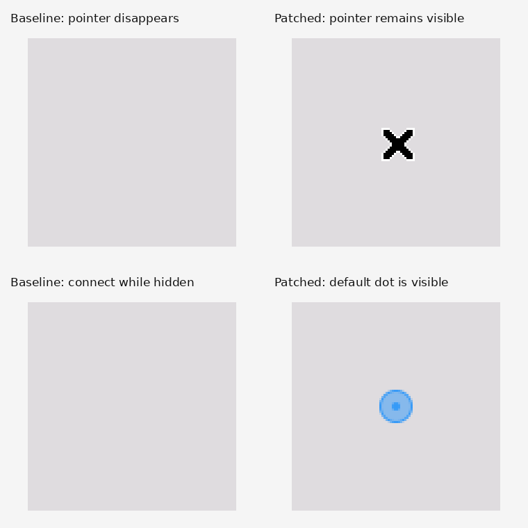

# RustDesk #16703: Linux X11 cursor validation

Baseline: `rustdesk/rustdesk` master `3e953e886a874956d8351d6c25e340ea82dd2343`.
Patch: `b98ff0cec91e0eac6c0247306b2db14f51198c91`.
Submodule: `hbb_common` `fae47e024dd83cef6aaecde0aa7d11731df11649`.

The PR changes only `src/platform/linux.rs`. This separate branch contains validation evidence and scripts, outside the PR diff.

## Visual result

These are enlarged crops of real Flutter screenshots. Cursor pixels were captured from the actual display with `ffmpeg -f x11grab -draw_mouse 1`; no pointer was added to the images.



| Scenario | Baseline | Patched |
| --- | --- | --- |
| Before entering the VNC window | Arrow visible | Arrow visible |
| Inside the nested application's hidden-cursor region | Invisible (0 nontransparent cursor pixels) | Last visible shape retained (176 pixels in this run) |
| Leaving the VNC window | Arrow restored | Arrow restored |
| Both server and controller restarted while host cursor is hidden | Invisible (0 pixels) | Flutter default blue dot visible (224 pixels) |

Full screenshots: [baseline inside](gui/baseline-inside.png), [patched inside](gui/fixed-inside.png), [baseline hidden startup](gui/baseline-start-hidden.png), [patched hidden startup](gui/fixed-start-hidden.png).

Original 10-second recordings: [baseline](gui/baseline-visual.mp4), [patched](gui/fixed-visual.mp4).

## Environment and scope

- Debian 13, x86_64, Rust 1.91.1. Native builds use project-supported system libraries through `linux-pkg-config`; `Cargo.lock` is unchanged.
- Xvfb host desktop `:91`, 1024x768; Xtigervnc nested desktop `:92`, 640x480, TigerVNC 1.15.0. An actual nested X11 application defines a fully transparent cursor. TigerVNC viewer runs on the host desktop.
- Official RustDesk 1.5.3 Linux Flutter controller runs in another Xvfb/Openbox desktop `:93`, 1280x960. It connects over loopback TCP and supplies actual remote mouse input. Actual video and cursor updates return to the Flutter GUI.
- [Official controller package](https://github.com/rustdesk/rustdesk/releases/download/1.5.3/rustdesk-1.5.3-x86_64.deb), SHA-256 `81096d2f65fd43352540c351bca15bb0712a2a6f9efa4c95e9fff25cb97b3b81`.
- The native test launcher calls production `new()` / `create_tcp_connection()` APIs with normal permanent-password challenge-response. It does not change authentication, video, input or cursor production code. It is not the main program's `--server` entry point.
- No physical monitor, Windows/macOS controller, package/service startup or public relay was tested. The XFixes fallback under Wayland was not exercised.

The retained shape can be an I-beam or another specialized cursor; in this visual run it was the VNC desktop's X-shaped cursor encountered immediately before the blank region. This is the accepted last-visible-shape policy rather than a newly synthesized fallback.

## Results

- [Native main-program build and DRM unit-test log](build.log).
- [Unit test with DRM disabled](test-no-drm.log).
- [8 real XFixes/VNC checks](x11-result.json).
- [12 real authenticated TCP cursor-service checks](network-checks.json), with [received cursor messages](network-result.json).
- [8 Flutter GUI states plus 4 host-hidden checks](gui/gui-summary.json).
- [GUI commands and raw observations](gui/gui-results.jsonl).
- [Native binary hashes](binary-hashes.json).

Both feature combinations passed the local alpha visibility unit test:

```sh
cargo test --locked --lib --features linux-pkg-config,drm cursor_image_tests -- --nocapture
cargo test --locked --lib --features linux-pkg-config cursor_image_tests -- --nocapture
```

## Reproduction scripts

The scripts preserve the paths used in the original container. They are validation material, not additions to the production repository's test infrastructure.

- [Original Debian/Rust build environment setup](linux-setup.sh).
- [X11/VNC dependencies and baseline source extraction](setup-x11.sh).
- [Baseline/patched native build](build.sh).
- [Actual XFixes API probe](cursor_probe.rs).
- [Actual native server/TCP receiver](cursor_network.rs).
- [X11 and TCP comparison runner](verify_x11.py).
- [Flutter GUI environment](gui_environment.py), [command helper](gui-command.ps1), [evidence assertions](final_gui_evidence.py).

For the original layout, `/work/rustdesk16703` contains the baseline source with its initialized submodule; `/work/16703-artifacts` holds these probe sources and the patched `linux-fixed.rs`. `build.sh` produces separately named baseline and patched native binaries there, using `/work/rustdesk/target` as the build cache. The original baseline and submodule archives are `/work/16703-source.tar` and `/work/16703-hbb.tar`.

Run the non-GUI comparison in that layout with:

```sh
RUN_NETWORK=1 /usr/bin/python3 /work/16703-artifacts/verify_x11.py
```

For GUI reproduction, extract the official deb with `dpkg-deb -x` under `/work/16703-gui/client`, install `ffmpeg` and `libayatana-appindicator3-1`, and run `gui_environment.py`. It accepts JSON commands in `/work/16703-gui/command.json`; the original sequence and responses are in `gui/gui-results.jsonl`. `gui-command.ps1` is the Windows-host helper used to send those commands to the Linux Docker container. The recorded password is a disposable local test credential, not a user password.
